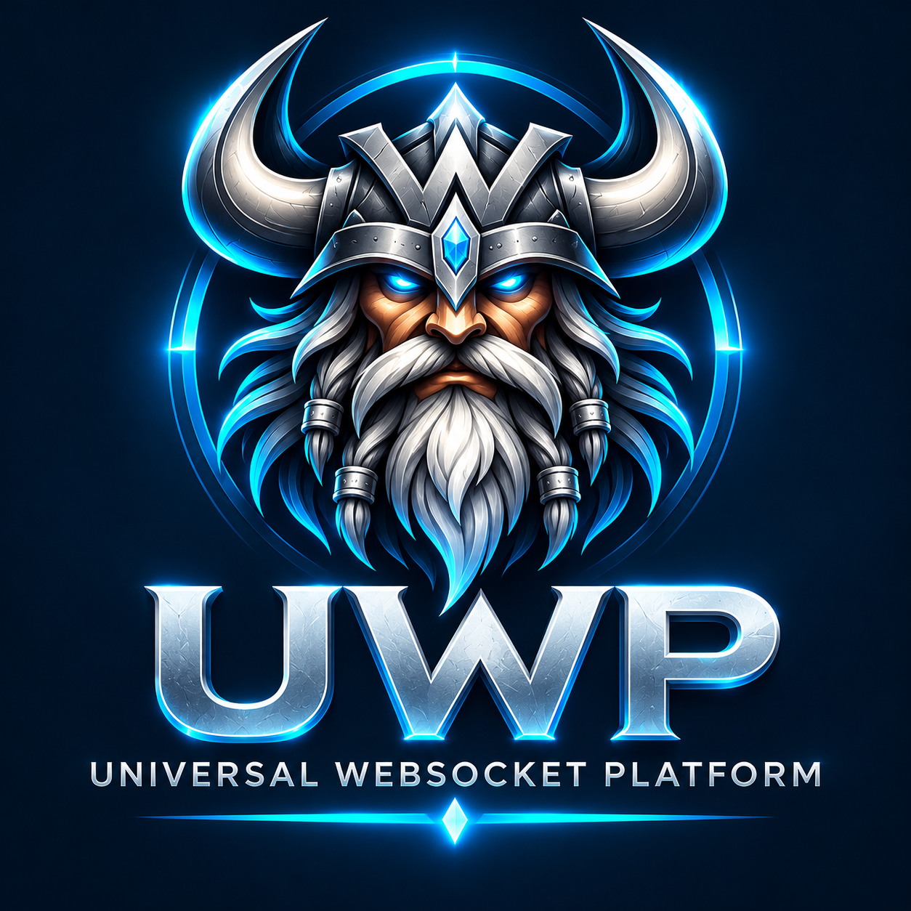
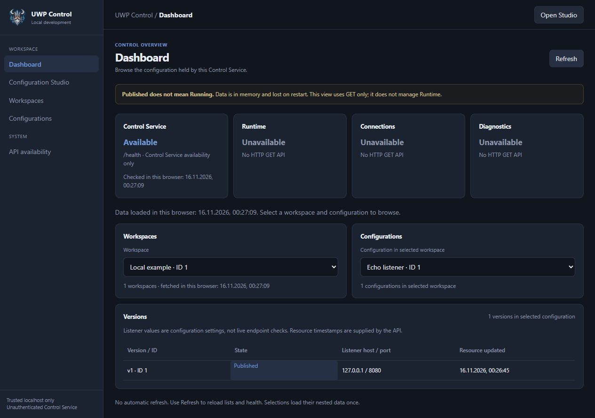
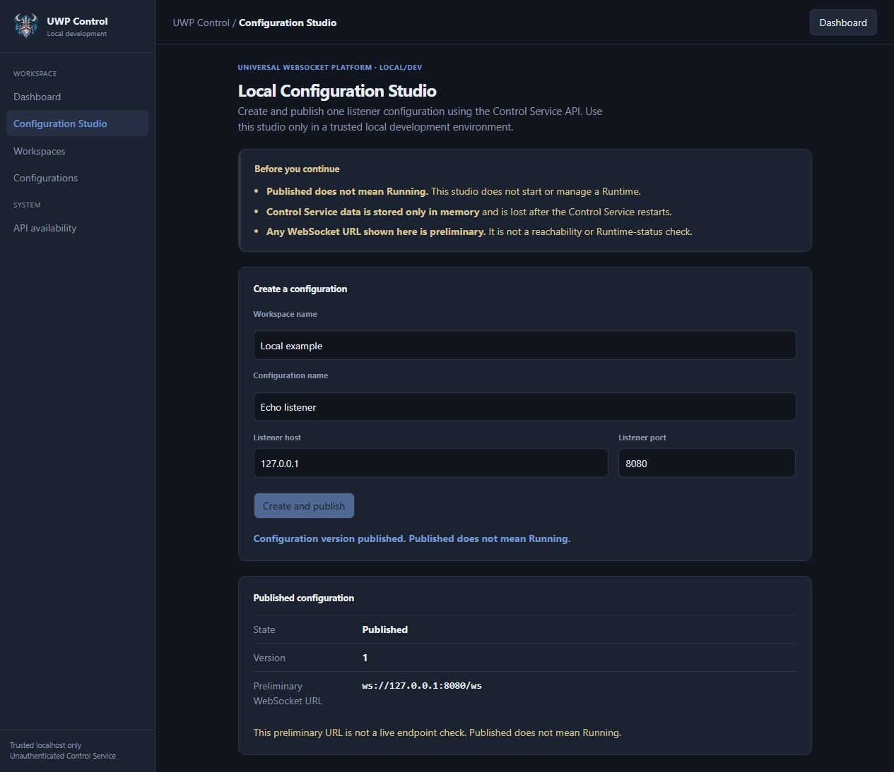

# Universal WebSocket Platform

<p align="center">
  
</p>

[Быстрый старт](docs/ru/quick-start.md) · [Dashboard](http://127.0.0.1:18085/dashboard) · [Configuration Studio](http://127.0.0.1:18085/)

[English version](README.md)

Universal WebSocket Platform — open-source платформа для создания, настройки, развертывания и эксплуатации независимых WebSocket-серверов без написания инфраструктурного кода.

## Статус

Проект находится на инженерной вехе **Beta — Complete the Single-Node
Runtime** и не готов к production-эксплуатации. Репозиторий содержит Control
Service, in-memory доменные API и собранную в production single-node Runtime
vertical с Authentication до Upgrade, детерминированной маршрутизацией,
транзакционной передачей Session и Manager-aware shutdown.

Текущий репозиторий также содержит встроенный **Local Configuration Studio**
в корне Control Service. Это UI только для trusted local development и одного
сценария поверх существующих API: создать Workspace, Configuration и Draft,
задать Listener host/port, опубликовать и увидеть возвращённые state/version и
предварительный WebSocket URL. `Published` не означает `Running`; данные
остаются in-memory и теряются после restart; URL не является проверкой
reachability. Studio не является production Admin UI и не запускает Runtime и
не управляет им.

Встроенный **UWP Control Dashboard** на `/dashboard` добавляет общую со Studio
оболочку Slate Blue и GET-only просмотр существующих Workspaces, Configurations
и Versions. Он показывает доступность Control Service, state версий, listener
host/port, доступное время изменения ресурса и время получения данных в браузере.
Runtime, Connections и Diagnostics явно недоступны: HTTP GET API не подключён.
Refresh выполняется вручную; polling и WebSocket probes отсутствуют.
Небезопасные для JavaScript integer IDs вызывают unsupported-response state до
вывода и вложенных запросов. Raw JSON и secret references не отображаются.
Unauthenticated сервис предназначен только для trusted localhost/same-origin.
Dashboard не делает Studio или существующий API read-only.
Endpoint `/health` подтверждает только доступность Control Service, не Runtime status.

Локальный запуск с Go, без npm и frontend build:

```powershell
$env:UWP_HTTP_HOST="127.0.0.1"
$env:UWP_HTTP_PORT="18085"
go run ./cmd/control-service
```

Откройте [Dashboard](http://127.0.0.1:18085/dashboard) или
[Configuration Studio](http://127.0.0.1:18085/). Без environment overrides
адрес по умолчанию — `127.0.0.1:8080`. После запуска списки пусты; создайте и
опубликуйте конфигурацию в Studio, вернитесь в Dashboard и выберите её Workspace
и Configuration. После перезапуска сервиса данные исчезают.

Configuration Loader, Snapshot Builder, Runtime Bootstrap и Launcher,
Lifecycle Owner, management routing, operational identity, command
idempotency и orchestration prerequisites также существуют изолированно. Они
не подключены к пути управления Runtime из Control Service: Production
Activation, реализации external persistence, recovery и reporting,
Control Service Runtime API отсутствуют. Runtime vertical поддерживает одну
startup-loaded TLS certificate/key pair и configured Session timeouts;
certificate rotation/reload и mTLS не реализованы.

## Скриншоты UWP Control

Реальный локальный UI с примером конфигурации. Published не означает Running.

### Dashboard



### Configuration Studio



## Текущий релиз

**Версия:** `v0.1.0-alpha`

**Зрелость релиза:** alpha

Этот опубликованный релиз содержит Control Service и базовый жизненный цикл
Workspace, Configuration и ConfigurationVersion. Текущий репозиторий содержит
более поздний, ещё не выпущенный инженерный прогресс Beta, описанный выше.
Подробности релиза приведены в
[заметках к релизу](docs/ru/releases/v0.1.0-alpha.md).

## Принципы проекта

- Configuration over Code
- Runtime Isolation
- API First
- Technology Neutrality
- Provider-based architecture
- Explainability
- Predictability
- Keep MVP Simple

## Документация

- [Главная страница документации](docs/ru/README.md)
- [Локальный быстрый старт](docs/ru/quick-start.md)
- [Архитектурные руководства](docs/ru/architecture/README.md)
- [Документы проектирования Runtime](docs/ru/design/README.md)
- [Архитектурные решения](docs/ru/adr/README.md)
- [Инженерный план развития](docs/ru/roadmap/README.md)
- [Архитектурные ревью](docs/ru/reviews/README.md)
- [Текущее состояние реализации](spec/current-state.md)
- [Инженерная Wiki](wiki/README.md)
- [Заметки к релизам](docs/ru/releases/)
- [Внутренние спецификации](spec/README.md)
- [Точка входа AI-агентов](AGENTS.md)
- [Внутренний инженерный процесс](docs/engineering/AGENT.md)
- [Задачи и отчёт о синхронизации](docs/tasks/README.md)

## Участие в разработке

Проект находится на активной инженерной стадии Beta. Перед тем как предлагать
изменения, прочитайте русскоязычную документацию и фактическое состояние
реализации. Архитектурные решения следует фиксировать до того, как они
превратятся в ограничения реализации.

## Лицензия

Условия лицензии приведены в файле `LICENSE`.
