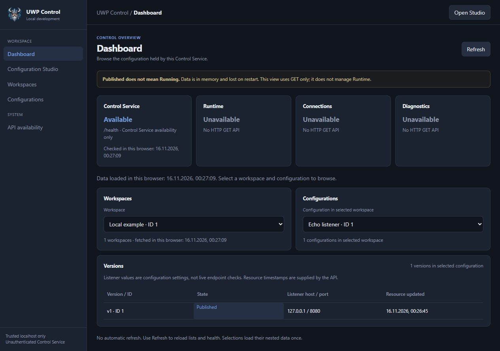
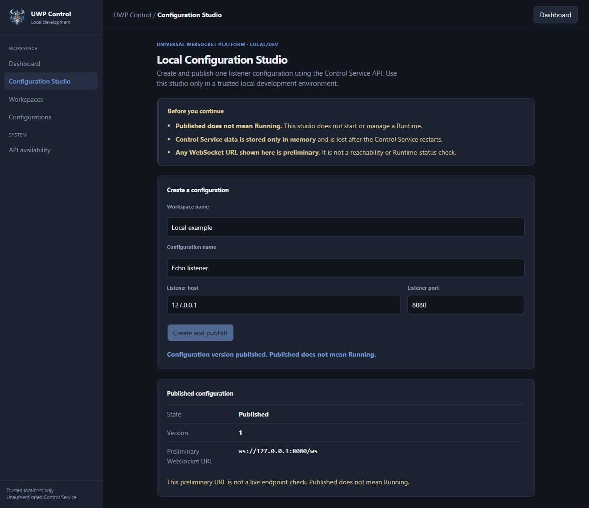

# Local Quick Start

[Russian version](../ru/quick-start.md) · [Documentation home](README.md) · [Project README](../../README.md)

Run UWP Control in a trusted local development environment. The Control Service
is unauthenticated; keep it on loopback. This guide uses the current repository,
which includes later work than the tagged `v0.1.0-alpha` release. It is not a
production deployment guide.

## Requirements

- A checkout of this repository and a Go toolchain compatible with its
  `go.mod` (`go 1.25.0`). Go 1.26.5 on Windows was used for this guide's smoke test.
- A free local TCP port. The examples use `18085`.
- No npm, frontend build, CDN or additional frontend dependencies.

## Start the Control Service

From the repository root, in PowerShell:

```powershell
$env:UWP_HTTP_HOST="127.0.0.1"
$env:UWP_HTTP_PORT="18085"
go run ./cmd/control-service
```

Or in a POSIX shell:

```sh
UWP_HTTP_HOST=127.0.0.1 UWP_HTTP_PORT=18085 go run ./cmd/control-service
```

Keep the process running while using the UI; stop it with `Ctrl+C`. Without
environment overrides, the service defaults to `127.0.0.1:8080`. If the port is
already in use, choose another `UWP_HTTP_PORT` and use it in the URLs below.
The startup log reports the actual address. These variables configure the
Control Service HTTP address, not a Runtime WebSocket listener.

These addresses point to your own computer. Dashboard and Configuration Studio
are available only after you start UWP locally as described above.

| Route | Purpose |
|---|---|
| [Dashboard](http://127.0.0.1:18085/dashboard) (`/dashboard`) | Read-only GET browsing; manual Refresh |
| [Configuration Studio](http://127.0.0.1:18085/) (`/`) | Create/publish or Draft in an existing Configuration |
| [Health](http://127.0.0.1:18085/health) (`/health`) | Control Service availability only |

A fresh service has no Workspaces. Empty lists are expected, not a failure.

Use the language button in either page header to switch between EN and RU.
The button shows the current language. English is the default, and both pages
use the saved browser preference. Switching in Studio keeps your current
selections and unsaved Draft edits. Use the main navigation to move between
Studio and Dashboard. On narrow screens, use the menu button beside EN/RU in
the global header. Select a link or press Escape to close the menu.
In Studio, a link that would leave a Draft with unsaved
changes opens a confirmation dialog. Cancel or Escape keeps the Draft open.
Reloading, closing the tab, or leaving through an external link uses the
browser’s leave-page warning when the Draft needs protection.

Beside EN/RU, select the sun to switch to **Light** or the moon to switch to
**Dark**. When no Light or Dark preference is saved, the theme follows OS
appearance changes. The browser shares the saved palette across both pages
of the same origin. Switching takes effect immediately and keeps unsaved
Draft edits and validation feedback.

## Create and publish a configuration

1. Open Configuration Studio at `/`.
2. Enter a Workspace name and Configuration name, for example `Local example`
   and `Echo listener`.
3. Keep Listener host `127.0.0.1` and port `8080`, or enter your intended
   configuration values. These are saved settings; they do not bind a listener.
4. Select **Create and publish**. Studio creates a Workspace, Configuration and
   Draft, sets the listener and publishes that version through the existing API.
5. Check the returned **Published** state, version and preliminary WebSocket URL.
   `Published` does not mean `Running`; the URL is not a reachability check.
6. Open Dashboard, choose the Workspace and Configuration, and inspect Versions,
   state, listener host/port and available timestamps. Use the circular-arrow
   **Refresh** button to reload the lists and check Control Service health.
   Dashboard refreshes only on demand.

Dashboard is read-only. Studio uses the existing mutation API; the shared shell
does not make the entire service read-only. The example names are illustrative
local data, not seeded product records or fabricated metrics.

## Use an existing Workspace or Configuration

In Studio, choose an **Action**:

- **New Workspace and Configuration** preserves the create-and-publish flow above.
- **New Configuration in existing Workspace** lets you select a Workspace,
  enter the new Configuration name and listener settings, then create and publish.
- **New Draft in existing Configuration** lets you select a Workspace and its
  Configuration, then create a fresh **Draft** only. Existing settings are not
  cloned; this action does not update the listener or publish the Draft.
  After confirmed creation, **Open created Draft** reads the current version
  and opens it in **Edit existing Draft** if it is still a Draft. If Studio
  cannot open it, the creation result stays visible and you can retry the read.

Changing Workspace clears the Configuration choice; changing Action or
Configuration clears the previous result. **Reload lists** refreshes available
resources. Empty lists are normal; a removed or inaccessible resource requires
reloading and selecting again. Studio does not create replacement parents.
Only one creation action runs at a time. After a partial failure or an unknown
request outcome, inspect Dashboard before explicitly starting another action;
mutations are not automatically retried and earlier created resources may remain.
Existing Draft listener editing is available through the separate action below;
archive and Runtime management remain unavailable.

## Open and save an existing Draft

1. Choose **Edit existing Draft** in Studio.
2. Select the existing Workspace and Configuration. Only its Draft versions are
   offered; choosing a Draft opens it through a fresh read, without creating one.
3. Choose **Listener address** to edit host/port and **Save listener**, or choose
   **Timeouts** to edit all four second values and **Save timeouts**. Handshake
   and write accept whole numbers 1–300; read and idle accept 0–86400 (zero
   disables that timeout). Every field is required. **Save timeouts** shows
   errors beside all invalid fields and focuses the first one. Correct a field
   to clear its error. Each Save updates only the
   selected section of the same Draft through one request; it never publishes.
   TLS, authentication, routing and the other editor section remain unchanged.
4. Switching editor section, Action, Workspace, Configuration or Draft, or reloading dirty data,
   asks before discarding local changes. Cancel keeps your edits and selections.
   The page also requests a browser warning when leaving with unsaved work;
   browser termination or crashes cannot guarantee that warning.
5. Save errors retain your input. If the outcome is unknown, Save stays blocked
   until you explicitly use **Reload Draft** to reconcile stored data. Confirmed
   reload replaces local values only after a successful read. Read values show
   current server state, not proof that an earlier uncertain request succeeded.

If the version was published, archived, removed or its parent became unavailable,
Save cannot silently create a replacement. Preserve your input and inspect the
current resources. Empty Draft lists are normal. Concurrent saves from other
clients can overwrite the saved section: the existing API has no revision, ETag
or CAS check. This editor does not provide TLS/authentication/routing controls,
archive or Runtime management.

### Publish a saved Draft

1. Open the Draft in **Edit existing Draft**. Save or discard any local edits.
   After an uncertain Save, use **Reload Draft** to check the stored version first.
2. Select **Publish Draft** and check the Configuration and Draft in the confirmation.
   Publishing archives any current Published version in that Configuration.
3. Confirm **Publish Draft**. Studio checks the stored Draft again, publishes it,
   and refreshes the versions. A detected change requires reloading the Draft.
   Another client can still make changes between the check and publication.

If the publish outcome is unknown, use **Refresh versions** to inspect current
server state. A Published or Archived state alone cannot establish the outcome
of the earlier request. Any new attempt requires a fresh Draft and a new
confirmation. If publication succeeds and the refresh fails, **Refresh versions**
only reads the list again. Publishing does not start Runtime.

### Listener address validation

Use a bare IPv4 or IPv6 address, or a supported hostname such as `localhost`.
A host made only of digits and dots with at least one dot must be a valid IPv4
address. Entries such as `192.168.1.999` and `127.0.0.1.` are rejected.
Port must be a decimal whole number from 1 to 65535. Studio shows errors by the
fields and checks them before sending the creation or address Save request.
Existing stored addresses remain readable. Correct an address that fails the
new rule before saving its Listener address section.

Creation uses separate requests. If the server rejects a later request after
an earlier step succeeded, inspect Dashboard for the Workspace, Configuration
or Draft already created. Saving an existing Draft address updates that Draft.

## Screenshots

Actual running local UI, captured after the example workflow above. The Viking
branding comes from the accepted asset set; these are not mockups.





## Product limitations

- **Published != Running.** Neither Studio nor Dashboard starts or manages Runtime.
- **`/health` covers Control Service only.** It does not confirm Runtime status,
  WebSocket reachability, connection counts or uptime.
- **Control Service data is in memory.** Workspaces, Configurations and Versions
  are lost when the service restarts; this flow does not provide persistence.
- **Runtime, Connections and Diagnostics have no connected HTTP GET API.**
  Dashboard displays them as unavailable, not zero or healthy.
- **Trusted local environment only.** Control Service has no authentication;
  keep the loopback/same-origin boundary and do not expose it publicly.

Resource update timestamps come from the API; browser checked/fetched times are
separate. Dashboard does not display raw JSON or secret references. See the
[current implementation state](../../spec/current-state.md) for implemented,
isolated and absent capabilities, and the [release notes](releases/v0.1.0-alpha.md)
for the earlier tagged release. Stage B and production activation remain inactive.
