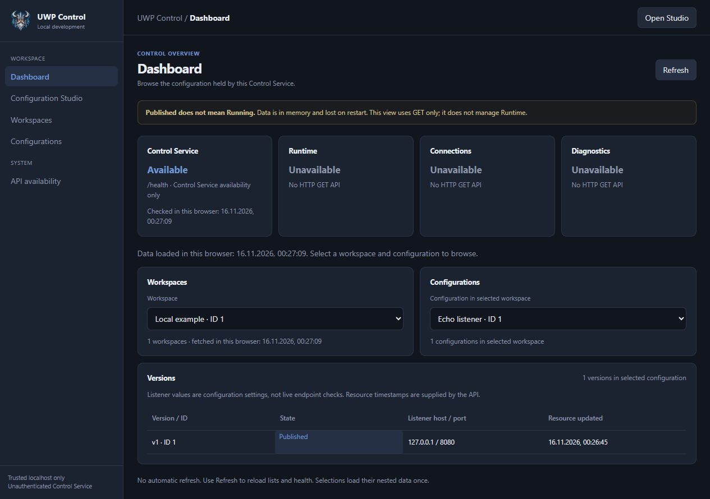
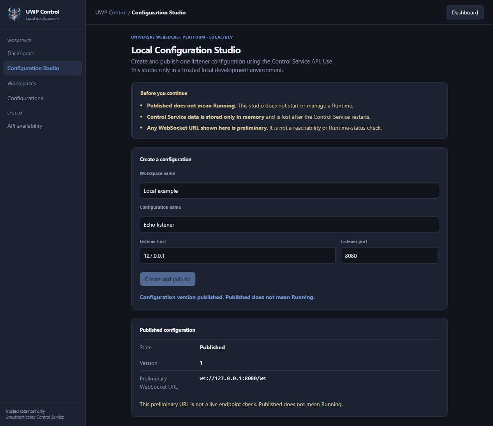

# Локальный быстрый старт

[English version](../en/quick-start.md) · [Главная документации](README.md) · [README проекта](../../README.ru.md)

Запускайте UWP Control только в trusted local development. Control Service
не имеет authentication; сохраняйте loopback-привязку. Инструкция относится
к текущему репозиторию, который содержит более поздние изменения, чем tagged
релиз `v0.1.0-alpha`. Это не инструкция production-развёртывания.

## Требования

- Checkout репозитория и Go toolchain, совместимый с его `go.mod`
  (`go 1.25.0`). Smoke этой инструкции выполнен с Go 1.26.5 на Windows.
- Свободный локальный TCP port. В примерах используется `18085`.
- npm, frontend build, CDN и дополнительные frontend dependencies не нужны.

## Запуск Control Service

Из корня репозитория в PowerShell:

```powershell
$env:UWP_HTTP_HOST="127.0.0.1"
$env:UWP_HTTP_PORT="18085"
go run ./cmd/control-service
```

Или в POSIX shell:

```sh
UWP_HTTP_HOST=127.0.0.1 UWP_HTTP_PORT=18085 go run ./cmd/control-service
```

Оставьте процесс работать во время использования UI; остановка — `Ctrl+C`.
Без environment overrides адрес по умолчанию — `127.0.0.1:8080`. Если port занят,
выберите другой `UWP_HTTP_PORT` и используйте его в URL ниже. Startup log
показывает фактический адрес. Эти переменные задают HTTP address Control Service,
а не WebSocket listener Runtime.

Эти адреса ведут на ваш компьютер. Dashboard и Configuration Studio доступны
только после локального запуска UWP по инструкции выше.

| Маршрут | Назначение |
|---|---|
| [Dashboard](http://127.0.0.1:18085/dashboard) (`/dashboard`) | Read-only GET просмотр; ручной Refresh |
| [Configuration Studio](http://127.0.0.1:18085/) (`/`) | Существующий create/publish flow |
| [Health](http://127.0.0.1:18085/health) (`/health`) | Только доступность Control Service |

После нового запуска Workspaces отсутствуют. Пустые списки ожидаемы и не являются ошибкой.

## Создание и публикация конфигурации

1. Откройте Configuration Studio на `/`.
2. Введите Workspace name и Configuration name, например `Local example`
   и `Echo listener`.
3. Оставьте Listener host `127.0.0.1` и port `8080` либо задайте нужные значения
   конфигурации. Это сохранённые настройки; они не привязывают listener.
4. Нажмите **Create and publish**. Studio создаёт Workspace, Configuration и
   Draft, задаёт listener и публикует эту версию через существующий API.
5. Проверьте возвращённые **Published**, version и preliminary WebSocket URL.
   `Published` не означает `Running`; URL не проверяет reachability.
6. Откройте Dashboard, выберите Workspace и Configuration, просмотрите Versions,
   state, listener host/port и доступные timestamps. **Refresh** перезагружает
   списки и Control Service health; автоматического polling нет.

Dashboard работает read-only. Studio использует существующий mutation API;
общая оболочка не делает весь сервис read-only. Имена в примере — иллюстративные
локальные данные, а не заранее добавленные продуктовые записи или фиктивные метрики.

## Скриншоты

Реальный работающий локальный UI после описанного сценария. Viking branding
использует принятый набор assets; изображения не являются mockups.





## Ограничения продукта

- **Published != Running.** Ни Studio, ни Dashboard не запускают Runtime и не управляют им.
- **`/health` относится только к Control Service.** Он не подтверждает Runtime status,
  WebSocket reachability, connection counts или uptime.
- **Данные Control Service in-memory.** Workspaces, Configurations и Versions
  теряются после restart; этот flow не обеспечивает persistence.
- **Runtime, Connections и Diagnostics не имеют подключённого HTTP GET API.**
  Dashboard показывает unavailable, а не нулевые показатели или healthy.
- **Только trusted local environment.** Control Service не имеет authentication;
  сохраняйте loopback/same-origin boundary и не выставляйте сервис публично.

Resource updated timestamps приходят из API; browser checked/fetched times
показаны отдельно. Dashboard не выводит raw JSON и secret references. Разделение
реализованных, изолированных и отсутствующих возможностей см. в
[текущем состоянии реализации](../../spec/current-state.md), более ранний tagged
релиз — в [заметках к релизу](releases/v0.1.0-alpha.md). Stage B и production
activation остаются неактивными.
